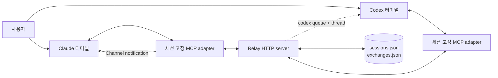

# Architecture

## 전체 구조

Claude와 Codex는 `stdio: inherit`로 실행되므로 사용자가 보는 interactive 화면과 입력 흐름을 그대로 유지한다. Relay는 화면을 읽거나 키를 쓰지 않는다.

## 프로세스

| 프로세스 | 역할 |
|---|---|
| Relay server | session/exchange HTTP API, JSON persistence, Codex delivery polling |
| Claude adapter | session ID가 고정된 MCP 도구, Channel candidate polling과 notification |
| Codex adapter | session ID가 고정된 MCP 도구 제공 |
| Provider CLI | 실제 대화, 모델 작업, 사용자 권한 UI |
| Launcher | session 등록, adapter 설정 생성, provider 실행, 종료 등록 |

## 모듈

| 파일 | 책임 |
|---|---|
| `src/types.ts` | provider, session, exchange, delivery attempt 타입 |
| `src/json-file.ts` | schema 검증을 포함한 동기 JSON read/write |
| `src/sessions.ts` | session 등록, 중복 방지, 갱신, 종료 |
| `src/exchanges.ts` | ownership, cwd guard, 상태 전이와 attempt 기록 |
| `src/tools.ts` | 6개 MCP 도구와 bound identity |
| `src/adapter.ts` | stdio MCP 서버, Claude Channel notification |
| `src/codex-queue.ts` | queue message 구성과 process 실행 |
| `src/delivery.ts` | Codex candidate polling, 중복 실행 방지, 실패 제한 |
| `src/server.ts` | loopback HTTP routing과 coordinator lifecycle |
| `src/launch.ts` | provider별 인자, runtime config, interactive process lifecycle |
| `src/cli.ts` | command parsing과 사용자 진입점 |
| `src/doctor.ts` | Relay, provider CLI 기능, 경로와 session 등록의 읽기 전용 사전 진단 |
| `scripts/session-start.cjs` | 선택적 provider lifecycle hook |

## 데이터 모델

`RelaySession`은 Relay 내부 `id`와 provider의 실제 `providerSessionId`를 분리한다. Codex의 경우 provider ID는 queue가 주소로 사용하는 thread ID다. `deliveryCommand`는 launcher가 사용한 정확한 Codex 실행 파일을 저장하고, 새 remote thread에는 launcher가 유지하는 loopback `deliveryRemote`도 저장한다.

`Exchange`는 질문, 제한된 context, answer, 현재 status, delivery attempt 배열과 방향별 `retryRequested`를 가진다. attempt에는 request/answer 방향, transport, sent/failed 결과, `automatic`/`explicit` trigger, 시간과 짧은 detail이 기록된다. 이전 JSON에 새 필드가 없으면 호환 기본값을 적용한다.

현재 저장은 `sessions.json`과 `exchanges.json` 두 파일이다. 기본 위치는 `~/.myade-relay`이며 `--data-dir` 또는 `RELAY_DATA_DIR`로 바꿀 수 있다. 단일 로컬 프로세스와 작은 개인용 데이터 규모를 전제로 한다.

## 요청 흐름

### Claude에서 Codex로

1. Claude adapter의 `relay_send`가 bound source ID로 exchange를 만든다.
2. server coordinator가 target Codex session의 thread ID, `deliveryCommand`, 선택적 `deliveryRemote`를 찾는다.
3. remote thread이면 `codex queue --remote`, 저장 thread이면 기존 `codex queue` 성공 시 request attempt를 `sent`, 상태를 `delivery_attempted`로 기록한다.
4. 열린 Codex가 notification을 처리해 `relay_receive`를 호출하면 `accepted`가 된다.
5. Codex가 `relay_reply`를 호출하면 `replied`가 된다.
6. Claude adapter가 answer candidate를 Channel로 알린다.
7. Claude가 `relay_collect`를 호출하면 `delivered`가 된다.

### Codex에서 Claude로

1. Codex가 `relay_send`로 exchange를 만든다.
2. Claude adapter polling이 request candidate를 발견한다.
3. Channel notification 성공은 `delivery_attempted`만 만든다.
4. 이후 receive, reply, Codex queue answer notification, collect 순서로 진행한다.

양방향 transport가 서로 다르더라도 receipt의 증거는 항상 MCP 상태 전이에서 나온다.

## HTTP API

| Method | 경로 | 용도 |
|---|---|---|
| `GET` | `/health` | server와 session 수 확인 |
| `GET`, `POST` | `/api/sessions` | 목록, 등록 |
| `PATCH`, `DELETE` | `/api/sessions/:id` | provider ID/status 갱신, 종료 |
| `GET`, `POST` | `/api/exchanges` | session 관련 요약, 새 요청 |
| `GET` | `/api/delivery/candidates` | adapter/coordinator가 보낼 후보 조회 |
| `POST` | `/api/exchanges/:id/receive` | target 수신 |
| `POST` | `/api/exchanges/:id/reply` | target 답변 |
| `POST` | `/api/exchanges/:id/collect` | source 회수 |
| `POST` | `/api/exchanges/:id/cancel` | source 취소 |
| `POST` | `/api/exchanges/:id/attempt` | transport 시도 기록 |
| `POST` | `/api/exchanges/:id/retry` | 소유권과 상태를 검사한 방향별 명시적 retry 요청 |

서버는 현재 인증을 제공하지 않는다. loopback 전용 개인 프로세스라는 신뢰 경계가 전제다. 외부 bind나 다중 사용자 지원을 추가하려면 인증, authorization, CSRF/Origin, rate limit과 데이터 격리를 별도 설계해야 한다.

## Provider 연결

Claude launcher는 임시 MCP config를 `.relay/runtime`에 만들고 `--strict-mcp-config`, `--mcp-config`, development Channel opt-in을 넘긴다. 일반 trust와 MCP permission UI는 그대로 보인다.

Codex launcher는 stdio MCP config를 command-line config로 전달한다. `--thread`가 있으면 `resume THREAD_ID`로 저장된 대화를 연다. `--thread`가 없으면 loopback WebSocket App Server를 유지하고 TUI를 `--remote`로 연결한다. TUI가 새 대화를 만든 뒤 App Server의 공식 `thread/started` notification을 관찰해 `thread.id`와 remote endpoint를 Relay session에 PATCH한다. 해당 session의 queue도 같은 endpoint에 `--remote`로 연결하며 approval이나 sandbox 우회 인자는 추가하지 않는다.

선택적 `session-start.cjs`는 `RELAY_BASE`, `RELAY_SESSION_ID`가 있을 때 hook payload의 provider session ID를 기존 Relay session에 PATCH한다. 설치된 provider hook과의 실제 통합은 아직 검증하지 않았다.

## 실패와 복구

- Codex request/answer 방향별 failed attempt가 2회가 되면 coordinator가 자동 재시도를 멈춘다.
- transport 성공 후 peer가 receive하지 않은 경우 상태는 `delivery_attempted`에 머문다.
- answer Channel/queue 성공은 attempt에 기록되며 source collect 전까지 `replied`다.
- 재시작 후 `queued`는 전송 후보로 복원되지만 방향별 실패 기록이 2회면 자동 전송하지 않는다. `delivery_attempted`는 상대의 명시적 수신 전까지 유지하며 자동 재전송하지 않는다. source의 명시적 retry가 있을 때만 request를 다시 보낸다.
- `replied`의 답 알림은 해당 방향의 성공 attempt가 없으면 전송 후보로 복원된다. 이미 성공 attempt가 있으면 자동으로 다시 보내지 않으며 target의 명시적 retry가 필요하다. source의 `relay_collect`만 `delivered`로 전이한다.
- 명시적 retry 요청은 JSON에 보존되며 다음 실제 transport attempt가 소비한다. 이 규칙은 새 server 인스턴스와 별도 프로세스 재시작에서 검증했다.
- transport가 성공했으나 attempt 기록 전에 프로세스가 갑자기 종료되는 창에서는 저장된 상태가 `queued`일 수 있다. 재시작 후 다시 보내면 중복 알림이 가능하다는 것은 현재 기록 순서에서의 추론이며, 이 창의 실제 provider 실험은 아직 수행하지 않았다.
- JSON 파일은 schema에 맞지 않으면 read 단계에서 실패한다. schema migration 체계는 아직 없다.

## 현재 제약

- remote App Server가 종료되면 해당 endpoint를 사용하는 queue 전달도 끝난다. launcher가 TUI와 App Server의 수명주기를 함께 관리한다.
- 동시 write를 하는 여러 Relay server process를 지원하지 않는다.
- 지속적인 다중 session 부하를 검증하지 않았다.
- macOS/Linux provider 실행을 실제 검증하지 않았다.
- Claude 시작 시 연결은 성공했지만 중복 MCP 경고가 표시된 사례가 있다.
